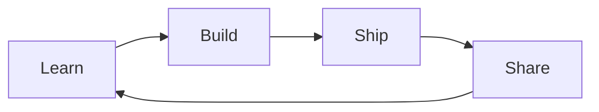

<div align="center">
  
</div>

<br/>

<div align="center">
  
  <h2>Welcome to my GitHub</h2>
  <p><b>Rahul Yadav</b> · Delhi, India · Building in public</p>

  <p>
    
    <a href="https://github.com/AppleID00x"></a>
    
  </p>
</div>

---

### ✨ About me

```text
┌─────────────────────────────────────────────────────┐
│  Name      : Rahul Yadav                            │
│  From      : Delhi, India                           │
│  Mindset   : Build → Learn → Improve → Repeat       │
│  Vibe      : Clean code, useful products, curiosity │
└─────────────────────────────────────────────────────┘
```

I'm a developer who genuinely **loves coding**. Right now I'm turning ideas into real projects, leveling up every week, and making this profile a place that shows what I'm becoming — not just what I've done.

- 🚀 Shipping personal projects in public
- 🧠 Learning modern web & software engineering by building
- 🎯 Obsessed with clean UI, clear READMEs, and useful tools
- 🤝 Always open to collabs, feedback, and cool ideas

---

### 🛠️ Toolbox I'm leveling up

<p align="center">
  
</p>

<p align="center">
  
  
  
  
  
  
  
</p>

---

### 🔥 Currently cooking

| 🎯 Focus | 💬 Status |
|:---|:---|
| Personal projects people actually want to use | 🚧 In progress |
| Strong foundations in web development | 🌱 Growing daily |
| Clean GitHub presence & documentation | ✅ Live |
| Consistent coding habit | 💪 Building streak |

---

### 📊 GitHub vibe check

<div align="center">
  
  
</div>

<br/>

<div align="center">
  
</div>

<br/>

<div align="center">
  
</div>

---

### 🗺️ Roadmap



---

### 💬 Let's connect

<div align="center">

**Got an idea? Want to collab? Just say hi.**

[](https://github.com/AppleID00x)


</div>
